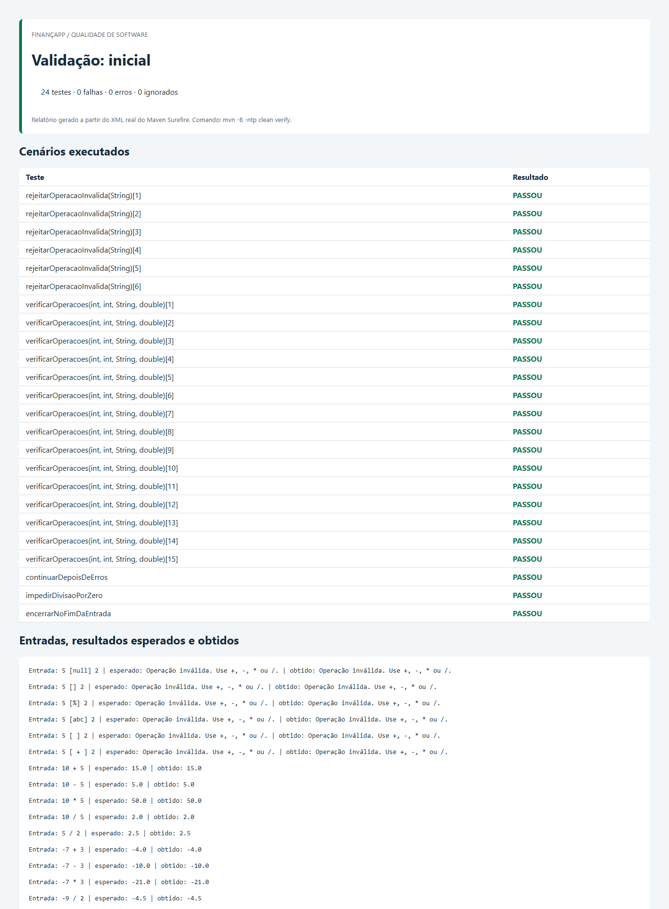
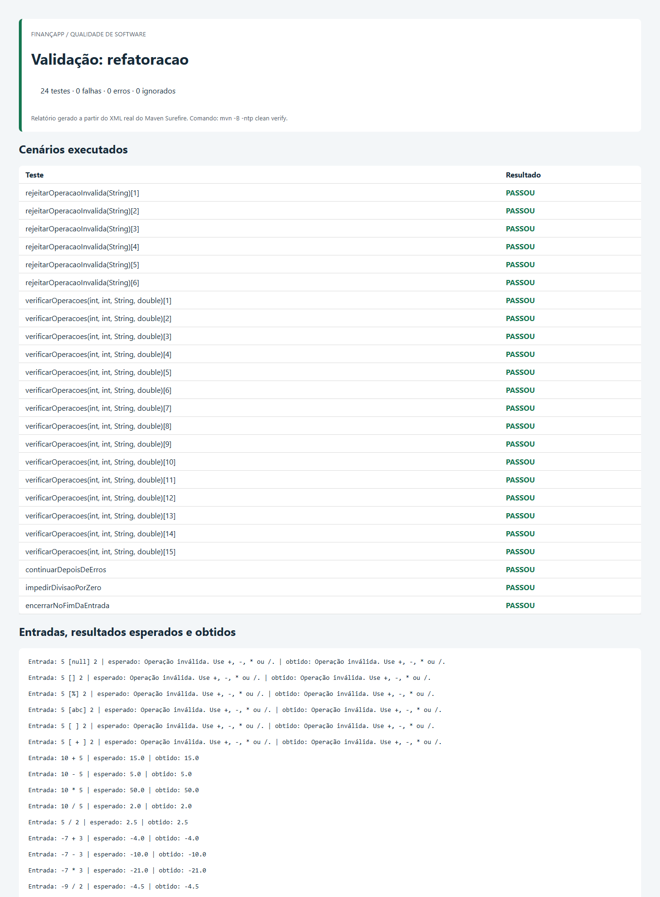
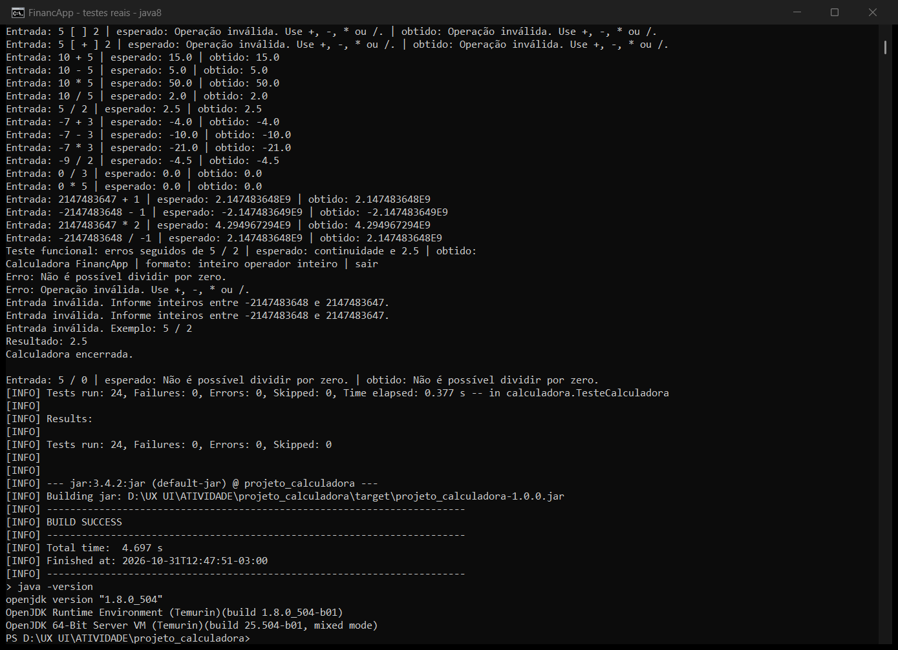
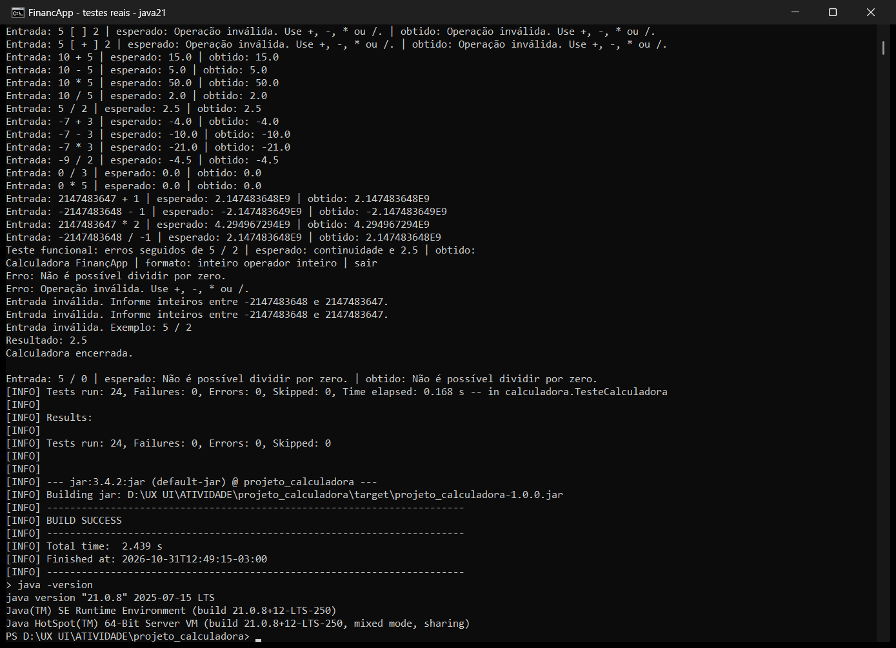
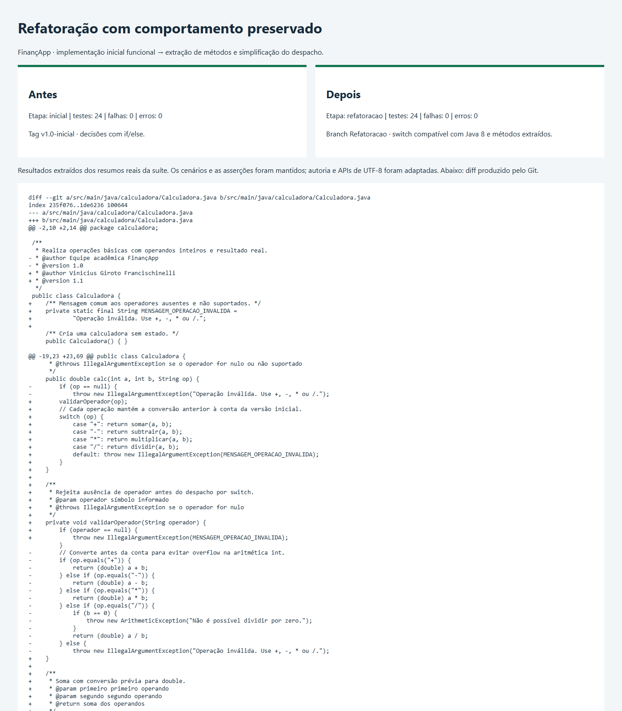
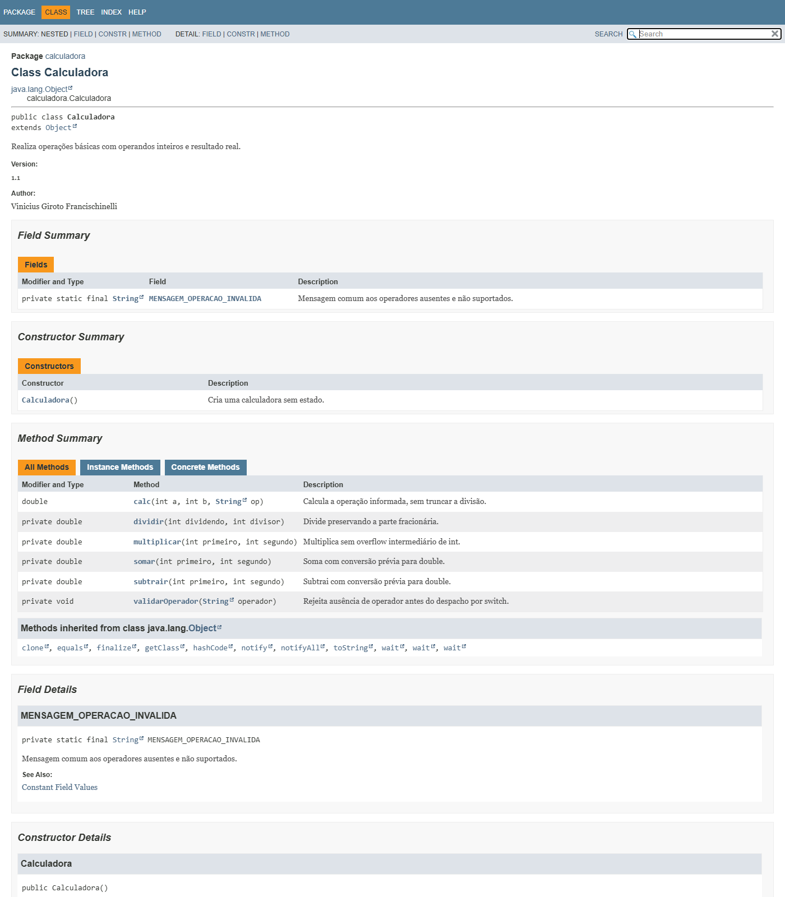

# Projeto Calculadora — FinançApp

> Projeto acadêmico de qualidade de software, testes, refatoração, documentação e versionamento.

## 1. Identificação do Projeto

| Campo | Informação |
| --- | --- |
| Projeto | projeto_calculadora |
| Contexto | FinançApp — startup fictícia |
| Aluno | Vinicius Giroto Francischinelli |
| RA | 250854 |
| Curso | Tecnologia em Análise e Desenvolvimento de Sistemas |
| Disciplina | UX/UI e Testes de Software |
| Professor | Daniel Domingos Akira de Sa Pimentel Ohata |
| Semestre | 2026.2 |
| Repositório | [VncsGiroto/projeto_calculadora](https://github.com/VncsGiroto/projeto_calculadora) |

Estrutura baseada no [exemplo da atividade](https://github.com/dr-ohata/calculadora_refatoracao/blob/main/README.md), complementada com instruções, testes e evidências.

## 2. Visão Geral

Módulo Java de cálculos básicos para o contexto fictício de finanças pessoais da FinançApp, com aplicações como orçamento mensal, divisão de despesas e projeções de economia.

A classe `Calculadora` concentra as operações. A classe `Aplicacao` fornece uma interface de terminal e trata erros para permitir novas tentativas. O projeto inclui testes automatizados, documentação HTML e evidências das versões inicial e refatorada.

## 3. Problema

A empresa precisa de um módulo matemático reutilizável, legível e testável. Além de calcular corretamente, o módulo deve rejeitar divisão por zero e operadores inválidos, comunicar falhas e permitir manutenção sem prejudicar seu comportamento.

## 4. Objetivo

### 4.1 Objetivo Geral

Desenvolver uma calculadora Java aplicando construção, validação, manutenção, documentação e versionamento de software.

### 4.2 Objetivos Técnicos

- Implementar `calc(int a, int b, String op)` no pacote `calculadora`.
- Validar as quatro operações e os cenários de erro.
- Demonstrar entradas, resultados esperados e obtidos.
- Refatorar uma implementação funcional e repetir os mesmos testes.
- Documentar classes, atributos, métodos, parâmetros, retornos e exceções.
- Gerar JavaDoc HTML em `docs/` e organizar commits e branches no GitHub.

## 5. Escopo Funcional

| ID | Funcionalidade | Exemplo | Resultado | Status |
| --- | --- | --- | --- | --- |
| RF01 | Soma | `10 + 5` | `15.0` | Validado |
| RF02 | Subtração | `10 - 5` | `5.0` | Validado |
| RF03 | Multiplicação | `10 * 5` | `50.0` | Validado |
| RF04 | Divisão | `5 / 2` | `2.5` | Validado |
| RF05 | Divisão por zero | `5 / 0` | Mensagem e nova tentativa | Validado |
| RF06 | Operador inválido | `5 % 2` | Mensagem e nova tentativa | Validado |

`calc` recebe dois operandos `int` e retorna `double`. A conversão acontece antes da operação, evitando overflow intermediário de `int` e preservando a parte fracionária da divisão. A API aceita exatamente `+`, `-`, `*` e `/`; rejeita operadores nulos, vazios ou com espaços. A interface separa os elementos por espaços e aceita inteiros negativos.

A API lança `ArithmeticException` para divisão por zero e `IllegalArgumentException` para operador inválido. A interface captura esses erros e também entradas não numéricas ou fora do intervalo de `int`, permitindo continuar.

Limite numérico: `double` tem precisão finita. Produtos grandes e algumas frações podem sofrer arredondamento. O projeto atende ao exercício; aplicações monetárias exigiriam regras específicas de precisão e arredondamento.

## 6. Requisitos Não Funcionais

| ID | Categoria | Atendimento |
| --- | --- | --- |
| RNF01 | Qualidade | Organização, indentação e responsabilidades separadas |
| RNF02 | Testabilidade | 24 execuções automatizadas em `TesteCalculadora.java` |
| RNF03 | Manutenção | Métodos extraídos, nomes claros e despacho com `switch` |
| RNF04 | Documentação | JavaDoc no código e HTML em `docs/` |
| RNF05 | Versionamento | Branches `main` e `Refatoracao`, commits e tag inicial |
| RNF06 | Confiabilidade | Mensagens e teste de continuidade após erros |

## 7. Tecnologias Utilizadas

| Tecnologia | Versão | Utilização |
| --- | --- | --- |
| Java / JDK | 8 (mínimo) | Linguagem, compilação e JavaDoc |
| Maven | 3.9.11 na validação | Dependências, testes e empacotamento |
| JUnit Jupiter | 5.11.4 | Testes unitários e parametrizados |
| Maven Surefire | 3.5.2 | Execução da classe `TesteCalculadora` |
| Git / GitHub | Controle de versão e hospedagem | Commits, branches e CI |
| PowerShell | Scripts opcionais | Evidências e JavaDoc |

Uma IDE é opcional. A primeira execução do Maven requer internet para baixar dependências.

## 8. Estrutura do Projeto

```text
projeto_calculadora/
├── src/
│   ├── main/java/calculadora/
│   │   ├── Aplicacao.java
│   │   ├── Calculadora.java
│   │   └── package-info.java
│   └── test/java/calculadora/
│       └── TesteCalculadora.java
├── docs/                         # JavaDoc HTML completo
│   └── index.html
├── evidencias/
│   ├── inicial/                  # Logs, cenários e relatório antes
│   └── refatoracao/              # Evidências após e diff
├── images/
│   ├── testes/
│   ├── javadoc/
│   └── refatoracao/
├── scripts/
│   ├── validar.ps1
│   ├── gerar-docs.ps1
│   ├── capturar-evidencias.ps1
│   ├── evidencia-terminal.ps1
│   └── capturar-terminal.ps1
├── .github/workflows/validacao.yml
├── .gitattributes
├── .gitignore
├── pom.xml
└── README.md
```

A estrutura padrão do Maven preserva o nome do projeto, o pacote e as classes exigidos.

## 9. Compilação e Execução

Na raiz do projeto, confirme `java -version` e `mvn -version`: ambos devem usar JDK 8 ou superior.

```shell
mvn clean verify
java -jar target/projeto_calculadora-1.0.0.jar
```

Exemplo de interação (entradas intercaladas com a saída):

```text
5 / 0
Erro: Não é possível dividir por zero.
5 % 2
Erro: Operação inválida. Use +, -, * ou /.
5 / 2
Resultado: 2.5
sair
Calculadora encerrada.
```

Informe um inteiro, um operador e outro inteiro, separados por espaços. `sair` ou o fim da entrada encerra normalmente.

## 10. Testes e Evidências

```shell
mvn test
```

São 24 execuções: 15 operações válidas, 6 operadores inválidos, 1 divisão por zero, 1 teste funcional de recuperação após erros e 1 teste de encerramento por fim da entrada. Incluem negativos, zero, divisão fracionária e limites de `int`.

As asserções verificam valores, tipo de exceção, mensagens e continuidade. As saídas registram entradas e resultados esperados e obtidos. O Surefire está configurado explicitamente para descobrir classes `Teste*.java`.

| Versão | Testes | Falhas | Erros |
| --- | --- | --- | --- |
| Inicial | 24 | 0 | 0 |
| Refatorada | 24 | 0 | 0 |





Os prints são capturas dos relatórios HTML derivados dos resultados reais do Maven Surefire. Consulte os [cenários iniciais](evidencias/inicial/cenarios.txt), os [cenários após refatoração](evidencias/refatoracao/cenarios.txt) e os logs `maven.log` nas mesmas pastas. Os relatórios completos são [inicial](evidencias/inicial/relatorio.html) e [refatorado](evidencias/refatoracao/relatorio.html); baixe e abra no navegador para visualizar o HTML.

Para atualizar as evidências no PowerShell:

```powershell
./scripts/validar.ps1 -Etapa refatoracao
```

O script gera logs, resumo e relatório HTML. Os prints representam a execução registrada e devem ser recapturados se código ou testes forem alterados.

### Capturas reais da execução no terminal

As imagens abaixo foram capturadas diretamente das janelas do terminal, após executar `mvn -B -ntp clean verify`. Mostram os cenários, o resumo de 24 testes sem falhas, `BUILD SUCCESS` e a versão real do Java utilizada. Não são simulações HTML.





Os logs completos estão em [Java 8](evidencias/compatibilidade/java8.log) e [Java 21](evidencias/compatibilidade/java21.log).

Para repetir a execução em uma janela PowerShell, substitua o caminho pelo seu JDK:

```powershell
./scripts/evidencia-terminal.ps1 -JavaHome 'C:\caminho\do\jdk8' -Nome java8
```

A versão atual utiliza sintaxe e APIs de Java 8. Foi compilada e testada com um JDK 8 real; o bytecode gerado tem versão 52, compatível com Java 8. A matriz do GitHub Actions também verifica Java 11, 17 e 21.

## 11. Processo de Refatoração

A tag [`v1.0-inicial`](https://github.com/VncsGiroto/projeto_calculadora/tree/v1.0-inicial) preserva a implementação funcional inicial. A branch [`Refatoracao`](https://github.com/VncsGiroto/projeto_calculadora/tree/Refatoracao) registra a evolução; a `main` recebe a versão final por merge, mantendo o histórico.

| Antes | Depois | Finalidade |
| --- | --- | --- |
| Sequência de `if/else` | `switch` tradicional, compatível com Java 8 | Simplificar seleção da operação |
| Contas dentro de `calc` | Métodos `somar`, `subtrair`, `multiplicar` e `dividir` | Organizar responsabilidades |
| Validação nula inline | Método `validarOperador` | Explicitar pré-condição |
| Mensagem repetida | Constante documentada | Centralizar texto |
| Nomes genéricos na divisão | `dividendo` e `divisor` | Melhorar leitura |

A assinatura pública, as mensagens e os resultados foram preservados. Os cenários e as asserções são os mesmos da tag inicial; a classe de testes recebeu apenas identificação do autor e adaptações das APIs de UTF-8 para Java 8, sem alterar entradas, resultados esperados ou asserções. A suíte foi executada nas duas versões: 24 testes aprovados em cada uma.

Veja a [comparação das versões](https://github.com/VncsGiroto/projeto_calculadora/compare/v1.0-inicial...Refatoracao) e o [diff da calculadora](evidencias/refatoracao/alteracoes.diff).



Para conferir pelo terminal:

```shell
git log --oneline --graph --all
git diff v1.0-inicial Refatoracao -- src/main/java/calculadora/Calculadora.java
git diff v1.0-inicial Refatoracao -- src/test
```

O último comando mostra a identificação do autor e ajustes das APIs de UTF-8 para Java 8, sem alterar os cenários ou as asserções. A tag inicial é um registro histórico anterior à adaptação e requer JDK 21. A entrega atual nas branches `main` e `Refatoracao` requer JDK 8 ou superior. Para testar a versão histórica inicial sem alterar o diretório atual:

```shell
git worktree add --detach ../calculadora-inicial v1.0-inicial
mvn -f ../calculadora-inicial/pom.xml clean verify
```

## 12. Documentação JavaDoc

Gerada com JDK 21, incluindo membros privados, validação estrita e avisos tratados como erros. O código utiliza `@author`, `@version`, `@param`, `@return` e `@throws` conforme aplicáveis. Métodos `void` não possuem retorno; a aplicação não possui atributos artificiais.

Abra [`docs/index.html`](docs/index.html) localmente no navegador. O GitHub exibe HTML como código: baixe ou clone o projeto para navegar pela documentação.



O script detecta o JDK: usa `-Xwerror` no Java 8 e `-Werror` nas versões mais novas para tratar avisos como erros. Para gerar novamente no PowerShell:

```powershell
./scripts/gerar-docs.ps1
```

Ou diretamente com o JDK:

```shell
javadoc -quiet -private -Xdoclint:all -encoding UTF-8 -docencoding UTF-8 -charset UTF-8 -author -version -notimestamp -d docs -sourcepath src/main/java -subpackages calculadora
```

## 13. Repositório e Entrega

- [Repositório completo e branch principal](https://github.com/VncsGiroto/projeto_calculadora)
- [Branch Refatoracao](https://github.com/VncsGiroto/projeto_calculadora/tree/Refatoracao)
- [Histórico de commits](https://github.com/VncsGiroto/projeto_calculadora/commits/main)
- [Validação no GitHub Actions](https://github.com/VncsGiroto/projeto_calculadora/actions)

O workflow compila e executa os testes com Java 8, 11, 17 e 21, e verifica o JavaDoc com JDK 21 a cada push ou pull request. A entrega reúne fontes, duas branches, evidências dos testes e da refatoração e documentação HTML.
